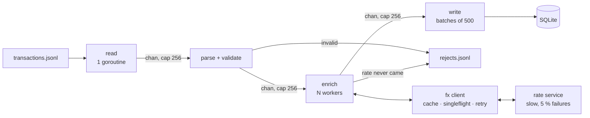

# Go Pipeline · Bounded, Cancellable Ingestion

[](https://github.com/edybackend/go-pipeline/actions/workflows/ci.yml)
[Leia em português](README.pt-BR.md)

A Go command-line tool that ingests a large transactions file. It streams the lines through **bounded stages**
connected by channels:
- **validate** each line;
- **convert** it to BRL with a **pool of workers** that call a slow, flaky exchange-rate service (cache, `singleflight`, retries with backoff);
- **write** in batches to SQLite.

A slow stage slows the others instead of filling memory. A fatal error cancels every stage through `errgroup`.
Ctrl+C commits the batch in hand, and **rerunning the same file finishes the job without duplicates**.

## Quick start

Requirements: Docker.

```bash
docker compose up --build
```

It generates 100,000 transactions (about 1 % invalid on purpose), ingests them with 32 workers and prints a report.
This one comes from a **rerun after an interrupted run**:

```
completed in 1.621s
  lines read          100000  (61675 lines/s)
  stored               98518
  already stored         495  (duplicates skipped)
  rejected               987  (see the rejects file)
  rate lookups           120  calls to the source 128, retries 8
  cache hits           98745  coalesced in flight 148
  rows in database     99013
```

The interrupted run had stored 495 rows; the rerun skipped them, and 98,518 + 495 + 987 = 100,000. The 120 lookups are
4 currencies × 30 days; every other record hit the cache or waited for a lookup already in flight.

Try other settings: `docker compose run --rm pipeline run -workers 1`.

<details>
<summary>Without Docker (Go 1.27)</summary>

```bash
go run ./cmd/pipeline generate -n 100000
go run ./cmd/pipeline run -workers 32          # Ctrl+C halfway, then run it again
```
Flags: `-workers`, `-buffer` (channel capacity), `-batch`, `-fx-latency`, `-fx-failures`, `-timeout`.
</details>

## How it works



- **Backpressure.** Every channel has a fixed capacity. If the database is slow, the writer stops taking items, the channels fill up and the reader stops reading. Memory does not grow with the file.
- **Worker pool.** Rate lookups are I/O, so they run in parallel. Concurrent lookups for the same (currency, day) are coalesced by `singleflight`; the result is cached; transient failures are retried with exponential backoff (5 attempts).
- **Cancellation.** All stages share an `errgroup` context. A fatal error (the database cannot be written) cancels everything and is returned. On SIGINT the batch in hand is still committed, and the tool exits with code 130.
- **Idempotent writes.** `INSERT … ON CONFLICT(id) DO NOTHING`: rerunning after an interruption stores only what is missing. No checkpoint file is needed.
- **Bad data is not an error.** Malformed lines, negative amounts, unknown currencies and bad timestamps go to `rejects.jsonl` with the line number and every reason. Records whose rate never comes go there too.

## Throughput by number of workers

100,000 lines, rate service with 40 ms latency and 5 % transient failures, fresh database. Measured on a 12-vCPU
container; your numbers will differ, the shape should not:

| Workers | Time | Lines/s |
|---:|---:|---:|
| 1 | 6.6 s | 15,131 |
| 4 | 2.8 s | 35,561 |
| 16 | 1.8 s | 56,765 |
| 64 | 1.6 s | 64,252 |

More workers help while the rate lookups (I/O) dominate. Once the cache is warm, the single SQLite writer is the limit,
so going from 16 to 64 workers adds little.

## How it is tested

| Behavior | Test |
|---|---|
| Every line ends stored or rejected; conversion is exact | `TestEveryLineIsStoredOrRejected` |
| A rerun stores nothing twice | `TestARerunStoresNothingTwice` |
| Interrupted mid-run → batch in hand committed → rerun completes, each valid line exactly once | `TestAnInterruptedRunCanBeRerunToCompletion` |
| A failing writer stops every stage, and no goroutine is left | `TestAFatalErrorStopsEveryStageAndLeaksNoGoroutine` |
| A stuck writer bounds how far the reader gets (< 100 of 5,000 lines) | `TestBackpressureBoundsHowFarTheReaderGets` |
| 50 concurrent lookups of one key → 1 call to the source | `TestConcurrentLookupsOfOneKeyMakeOneCall` |
| Retries with backoff; non-transient errors and cancellation are not retried | `fx` tests |
| The real binary: SIGINT → exit 130 → rerun → stored + rejected = 50,000 | CI job `run` |

Everything runs with `-race`. A mutation proves the backpressure test is real: with an unbounded first channel, the reader reads all 5,000 lines.

## Tech stack

| Area | Choice |
|---|---|
| Language | Go 1.27, standard library + `golang.org/x/sync` (`errgroup`, `singleflight`) |
| Storage | SQLite via `modernc.org/sqlite` (pure Go, no CGO), batched transactions, WAL |
| Quality | table-driven tests, `-race`, golangci-lint, gofmt |
| Delivery | distroless non-root image, Docker Compose, GitHub Actions |

## Project structure

```
cmd/pipeline/        CLI: generate / run, flags, signals, report
internal/record/     parse and validate a line (all problems at once)
internal/fx/         rate client: cache, singleflight, retries; simulated slow, flaky source
internal/pipeline/   the stages, channels, worker pool and errgroup
internal/store/      idempotent batch writes, per-account totals
internal/generate/   deterministic sample data with ~1 % invalid lines
specs/               feature specs (spec-first workflow)
```

## Design decisions

- **Channels sized from config, not unbounded.** Unbounded buffers hide a slow stage until memory runs out.
- **The sender closes the channel; every goroutine has an owner.** The producer of each channel closes it, and `errgroup`/`WaitGroup` wait for every goroutine. The tests count goroutines after a failure.
- **`singleflight` plus a cache, not a cache alone.** Without coalescing, 32 workers that start at once make 32 calls for the same key. The cache is checked again inside the flight, to close the gap between a miss and the call.
- **Idempotent writes instead of checkpoints.** Parallel workers finish out of order, so "last processed line" is not well defined. A natural key makes reruns trivially correct.
- **Integer money.** The rate is scaled to 4 decimals and the conversion is integer arithmetic with half-up rounding.

## Known trade-offs

- **One SQLite writer** is the ceiling once rates are cached; a server database with several writers, or `COPY`, would go further.
- **Unordered processing.** Output order is not input order. That is fine for an idempotent sink, but an ordered sink would need sequence numbers and a reorder buffer.
- **An in-memory cache** for one run; a long-running service would bound it (LRU) and expire entries.
- **Rejects are overwritten** on each run; a production job would version them per run.

## Working with an AI agent

Concurrency bugs hide well in review, so the habits that prevent them are checked mechanically. Hooks in [`.claude/`](.claude) refuse `context.Background()`, `time.Sleep` and oversized channel buffers inside `internal/`, and run vet and the race tests before a change counts as done. [`CLAUDE.md`](CLAUDE.md) has the rest of the rules.

## License

[MIT](LICENSE)
