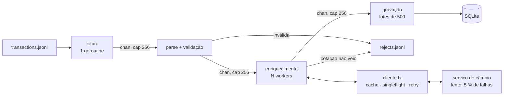

# Go Pipeline · Ingestão limitada e cancelável

[](https://github.com/edybackend/go-pipeline/actions/workflows/ci.yml)
[Read in English](README.md)

Uma ferramenta de linha de comando em Go que ingere um arquivo grande de transações. As linhas passam por **estágios
limitados**, ligados por canais:
- **validar** cada linha;
- **converter** para BRL, com um **pool de workers** que chama um serviço de câmbio lento e instável (cache, `singleflight`, novas tentativas com backoff);
- **gravar** em lotes no SQLite.

Um estágio lento freia os outros, em vez de encher a memória. Um erro fatal cancela todos os estágios via `errgroup`.
O Ctrl+C grava o lote em andamento, e **rodar o mesmo arquivo de novo termina o trabalho sem duplicatas**.

## Como rodar

Requisito: Docker.

```bash
docker compose up --build
```

O comando gera 100.000 transações (cerca de 1 % inválidas de propósito), ingere com 32 workers e imprime um relatório.
Este exemplo vem de uma **nova execução depois de uma interrompida**:

```
completed in 1.621s
  lines read          100000  (61675 lines/s)
  stored               98518
  already stored         495  (duplicates skipped)
  rejected               987  (see the rejects file)
  rate lookups           120  calls to the source 128, retries 8
  cache hits           98745  coalesced in flight 148
  rows in database     99013
```

A execução interrompida tinha gravado 495 linhas; a nova pulou essas, e 98.518 + 495 + 987 = 100.000. As 120 consultas
são 4 moedas × 30 dias; todo o resto veio do cache ou esperou uma consulta que já estava em andamento.

Teste outras configurações: `docker compose run --rm pipeline run -workers 1`.

<details>
<summary>Sem Docker (Go 1.27)</summary>

```bash
go run ./cmd/pipeline generate -n 100000
go run ./cmd/pipeline run -workers 32          # Ctrl+C no meio, depois rode de novo
```
Flags: `-workers`, `-buffer` (capacidade dos canais), `-batch`, `-fx-latency`, `-fx-failures`, `-timeout`.
</details>

## Como funciona



- **Backpressure.** Todo canal tem capacidade fixa. Se o banco fica lento, o gravador para de consumir, os canais enchem e a leitura para. A memória não cresce com o arquivo.
- **Pool de workers.** As consultas de câmbio são I/O, então rodam em paralelo. Consultas simultâneas do mesmo (moeda, dia) são unificadas pelo `singleflight`; o resultado vai para o cache; falhas transitórias são repetidas com backoff exponencial (5 tentativas).
- **Cancelamento.** Todos os estágios compartilham o contexto de um `errgroup`. Um erro fatal (o banco não grava) cancela tudo e é devolvido. No SIGINT, o lote em andamento ainda é gravado, e a ferramenta sai com código 130.
- **Gravação idempotente.** `INSERT … ON CONFLICT(id) DO NOTHING`: rodar de novo depois de uma interrupção grava só o que faltou, sem arquivo de checkpoint.
- **Dado ruim não é erro.** Linhas malformadas, valores negativos, moedas desconhecidas e datas inválidas vão para `rejects.jsonl` com o número da linha e todos os motivos. Registros cuja cotação nunca chega também vão para lá.

## Vazão por número de workers

100.000 linhas, serviço de câmbio com 40 ms de latência e 5 % de falhas transitórias, banco limpo. Medido num contêiner
com 12 vCPUs; os seus números vão ser outros, mas a forma da curva deve ser a mesma:

| Workers | Tempo | Linhas/s |
|---:|---:|---:|
| 1 | 6,6 s | 15.131 |
| 4 | 2,8 s | 35.561 |
| 16 | 1,8 s | 56.765 |
| 64 | 1,6 s | 64.252 |

Mais workers ajudam enquanto as consultas de câmbio (I/O) dominam. Com o cache quente, o gravador único do SQLite vira o
limite, e passar de 16 para 64 workers acrescenta pouco.

## Como é testado

| Comportamento | Teste |
|---|---|
| Toda linha termina gravada ou rejeitada; a conversão é exata | `TestEveryLineIsStoredOrRejected` |
| Rodar de novo não grava nada duas vezes | `TestARerunStoresNothingTwice` |
| Interrompida no meio → lote em andamento gravado → nova execução completa, cada linha válida exatamente uma vez | `TestAnInterruptedRunCanBeRerunToCompletion` |
| Um gravador com falha para todos os estágios, sem sobrar goroutine | `TestAFatalErrorStopsEveryStageAndLeaksNoGoroutine` |
| Gravador travado limita até onde a leitura vai (< 100 de 5.000 linhas) | `TestBackpressureBoundsHowFarTheReaderGets` |
| 50 consultas simultâneas da mesma chave → 1 chamada à fonte | `TestConcurrentLookupsOfOneKeyMakeOneCall` |
| Retentativas com backoff; erros não transitórios e cancelamento não são repetidos | testes de `fx` |
| O binário real: SIGINT → código 130 → nova execução → gravadas + rejeitadas = 50.000 | job `run` do CI |

Tudo roda com `-race`. Uma mutação prova que o teste de backpressure é real: com o primeiro canal sem limite, a leitura consome as 5.000 linhas.

## Tecnologias

| Área | Escolha |
|---|---|
| Linguagem | Go 1.27, biblioteca padrão + `golang.org/x/sync` (`errgroup`, `singleflight`) |
| Armazenamento | SQLite via `modernc.org/sqlite` (Go puro, sem CGO), transações em lote, WAL |
| Qualidade | testes em tabela, `-race`, golangci-lint, gofmt |
| Entrega | imagem distroless sem root, Docker Compose, GitHub Actions |

## Estrutura

```
cmd/pipeline/        CLI: generate / run, flags, sinais, relatório
internal/record/     parse e validação de uma linha (todos os problemas de uma vez)
internal/fx/         cliente de câmbio: cache, singleflight, retentativas; fonte simulada lenta e instável
internal/pipeline/   os estágios, canais, pool de workers e errgroup
internal/store/      gravação idempotente em lote, totais por conta
internal/generate/   dados de exemplo determinísticos com ~1 % de linhas inválidas
specs/               especificações (spec primeiro)
```

## Decisões de design

- **Canais dimensionados pela configuração, nunca ilimitados.** Buffer ilimitado esconde o estágio lento até a memória acabar.
- **Quem envia fecha o canal; toda goroutine tem dono.** O produtor de cada canal o fecha, e `errgroup`/`WaitGroup` esperam todas as goroutines. Os testes contam as goroutines depois de uma falha.
- **`singleflight` + cache, não só cache.** Sem unificar, 32 workers que começam juntos fazem 32 chamadas para a mesma chave. O cache é conferido de novo dentro da consulta, para fechar a janela entre o "não achei" e a chamada.
- **Gravação idempotente em vez de checkpoint.** Com workers em paralelo, a ordem de término varia, então "última linha processada" não tem definição clara. Uma chave natural deixa a nova execução correta sem esforço.
- **Dinheiro inteiro.** A cotação é escalada para 4 casas, e a conversão usa aritmética inteira com arredondamento para cima na metade.

## Trade-offs conhecidos

- **Um gravador SQLite** é o teto quando as cotações já estão em cache; um banco servidor com vários gravadores, ou `COPY`, iria além.
- **Processamento fora de ordem.** A ordem de saída não é a de entrada. Isso não importa para um destino idempotente, mas um destino ordenado precisaria de números de sequência e um buffer de reordenação.
- **Cache em memória** por execução; um serviço de longa duração limitaria o tamanho (LRU) e expiraria entradas.
- **As rejeitadas são sobrescritas** a cada execução; um job de produção guardaria um arquivo por execução.

## Trabalhando com um agente de IA

Bugs de concorrência se escondem bem na revisão, então os hábitos que os evitam são conferidos de forma mecânica. Hooks em [`.claude/`](.claude) recusam `context.Background()`, `time.Sleep` e buffers de canal gigantes em `internal/`, e rodam vet e os testes com race antes de a mudança valer. O [`CLAUDE.md`](CLAUDE.md) tem o resto das regras.

## Licença

[MIT](LICENSE)
